# ACADEMIC PROJECT REPORT

## 1. Title
**Smart Food Distribution and Food Waste Reduction System ("Annam")**  
*A Java OOP & Data Structures / Algorithms Simulation for Time-Critical Logistical Logistics*

---

## 2. Abstract
Surplus food redistribution from urban food producers (hotels, cafeterias, educational institutions) to hunger-relief agencies (shelters, elderly homes, community pantries) is plagued by logistical inefficiencies. Food items are highly perishable and bound by strict use-by deadlines. Current informal volunteer networks coordinate through uncoordinated phone calls, leading to avoidable food spoilage, double allocations, travel delays beyond use-by times, and capacity mismatches. 

This project implements **"Annam"**, an automated, time-sensitive food distribution management system developed in Java. Built upon the principles of Object-Oriented Programming (OOP) and classical Data Structures and Algorithms (DSA), the system employs a Min-Heap-based **PriorityQueue** for earliest-use-by-first scheduling, **HashMaps** for $O(1)$ entity retrieval, an **Adjacency-List Weighted Graph** to model urban roads, and **Dijkstra's Algorithm** for travel-time minimization and deadline feasibility verification. Through a 19-option console interface and a simulated clock, the system validates that surplus food is safely allocated, reserved, and transported before its declared use-by time while preserving unallocated remainders.

---

## 3. Case Study: The "Annam" Volunteer Network
"Annam" is a grassroots volunteer network that rescues surplus food from bulk producers and transports it to local welfare organizations. In everyday operations, volunteers receive donation alerts from hotel banquet halls, college messes, and bakeries. They manually attempt to locate an open vehicle and contact shelters to deliver the food.

Under this manual operation, four critical failure modes occur:
1. **Uncollected Perishables**: Food with a short shelf-life (e.g., 90 minutes) sits idle while volunteers mistakenly deliver a non-perishable batch donated later.
2. **Recipient Over-Allocation**: A single small shelter is assigned 100 portions despite having a refrigeration capacity of only 30 portions, causing the excess to spoil.
3. **Deadline Violations**: A volunteer sets off on a cross-city journey during congested hours, arriving after the food's declared use-by time.
4. **Duplicate Reservations**: Two volunteers independently dispatch vehicles to pick up the same food batch for two different centres, resulting in conflict and wasted fuel.

---

## 4. Problem Statement
To design and implement an algorithmically sound, object-oriented Java system that:
- Ingests surplus food batches with declared use-by timestamps and operator approval states.
- Prioritizes batches strictly in **earliest-use-by-first** order with deterministic tie-breaking.
- Validates recipient compatibility dynamically using polymorphic behavior.
- Computes the shortest travel path using Dijkstra’s algorithm and strictly rejects journeys where:
  $$\text{Pickup Time} + \text{Shortest Travel Time} + \text{Fixed Handover Allowance} \ge \text{Use-By Time}$$
- Allocates portions safely using bounded minimization:
  $$\min(\text{Available Portions}, \text{Recipient Demand}, \text{Vehicle Capacity})$$
- Retains unallocated remainders for subsequent distribution.
- Enforces two-phase reservations to completely eliminate double reservations.

---

## 5. Objectives
1. **Demonstrate Core OOP**: Implement Encapsulation, Inheritance, Runtime Polymorphism, Abstraction, and Composition across clean domain models.
2. **Apply Data Structures**: Implement Java PriorityQueue, HashMap, custom Adjacency List Graph, and ArrayList without third-party frameworks.
3. **Implement Dijkstra's Algorithm**: Execute pathfinding on a weighted graph using an internal Min-Heap for real-time travel calculations.
4. **Simulate Time-Sensitive Logistics**: Model a configurable simulated clock that drives batch expiry and delivery deadlines without blocking system threads.
5. **Guarantee Reliability**: Verify edge cases through an automated test harness covering all 10 project validation rules.

---

## 6. Existing Manual System
The existing manual system relies on telephone calls, messaging groups, and manual log sheets:
- **No Global Priority Queue**: Donations are dispatched first-come, first-served rather than earliest-expiry-first.
- **No Route Optimization**: Drivers take arbitrary roads without knowing travel times or calculating if arrival will occur before spoilage.
- **No Concurrency or State Safeguards**: Verbal agreements create phantom reservations and double-promising.
- **Lost Remainders**: When a batch is partially taken, the remainder is forgotten or discarded.

---

## 7. Proposed System
The proposed "Annam" system formalizes the lifecycle of surplus food into clear operational stages:
1. **Ingestion & Admin Approval**: Batches are cataloged with portions, category, pickup node, and use-by time, requiring admin approval before entering the active pool.
2. **Deterministic Priority Queue**: Approved batches are organized in a Min-Heap PriorityQueue keyed on `declaredUseByTime` and `batchId`.
3. **Policy-Driven Matching**: A 12-rule strategy engine evaluates batch validity, recipient category acceptance, remaining demand, vehicle status, road reachability, and deadline feasibility.
4. **Two-Phase Commit (Reservation $\rightarrow$ Confirmation)**: Portions and vehicle availability are locked in a `RESERVED` state before final delivery confirmation.
5. **Remainder Management**: Any unallocated portion remains registered in the active system.
6. **Clock-Driven Expiry**: Expiry scans identify depleted/expired batches and immediately purge them from the PriorityQueue.

---

## 8. Assumptions
1. All travel time weights between road nodes are positive ($w > 0$) and symmetric.
2. A fixed handover allowance of **10 minutes** is required at the recipient location for unloading and quality check.
3. The system relies on declared use-by times provided by donors; it does not biochemically certify food safety.
4. Simulation advances discretely through operator input; no background multi-threaded sleep intervals are required.
5. Portions are discrete positive integers.

---

## 9. Functional Requirements
- **FR1**: System must support exactly 5 donors, 4 recipients, 3 vehicles, 12 locations, and $\ge 20$ food batches.
- **FR2**: Operator must be able to view and adjust the simulated clock (`HH:mm`).
- **FR3**: Batches must remain unallocatable until explicitly approved by an operator.
- **FR4**: PriorityQueue must return batches in earliest-use-by order, resolving ties via Batch ID.
- **FR5**: Subclasses `Shelter` and `CommunityCentre` must filter food categories polymorphically.
- **FR6**: Dijkstra algorithm must compute shortest travel paths and identify unreachable destinations.
- **FR7**: Allocations must reject any trip where completion time exceeds the declared use-by deadline.
- **FR8**: System must prevent duplicate reservations, negative portions, and delivery confirmation without prior reservation.
- **FR9**: Unallocated batch remainders must be preserved and remain allocatable.
- **FR10**: Expiry scanner must flag expired batches and remove them from the PriorityQueue.

---

## 10. Non-Functional Requirements
- **Performance**: $O(1)$ lookups via HashMaps; $O((V + E) \log V)$ pathfinding via Dijkstra.
- **Robustness & Integrity**: Encapsulated state mutators prevent invalid or negative balances.
- **Usability**: 19-option menu-driven console with formatted tables and descriptive error messages.
- **Portability**: Pure Java 17+ implementation with zero external dependencies, database drivers, or web servers.

---

## 11. System Workflow

```
[Donor Ingestion] 
       │
       ▼
[Admin Approval Gate] ──(NOT APPROVED)──> [Held / Inactive]
       │
   (APPROVED)
       │
       ▼
[Insert into PriorityQueue] (Min-Heap by Earliest Use-By)
       │
       ▼
[Matching Policy Evaluation]
   ├─ Check Expiry against Simulated Clock
   ├─ Check Recipient Compatibility (Polymorphism)
   ├─ Check Vehicle Capacity & Availability
   ├─ Compute Shortest Path via Dijkstra Algorithm
   └─ Check Feasibility: Pickup + Travel + Handover < Use-By
       │
   (FEASIBLE)
       │
       ▼
[Create PROPOSED Allocation] ──> Allocated = min(Batch, Demand, Vehicle)
       │
       ▼
[Step 1: RESERVE Portions] ──> Deduct Available, Mark Vehicle BUSY, Retain Remainder
       │
       ▼
[Step 2: CONFIRM Delivery] ──> Mark DELIVERED, Relocate Vehicle, Free Vehicle
```

---

## 12. UML Class Diagram

### Mermaid Class Diagram

```mermaid
classDiagram
    class Location {
        -String locationId
        -String name
        -String areaType
        +getLocationId() String
        +getName() String
    }

    class Edge {
        -Location destination
        -int travelTimeMinutes
        +getDestination() Location
        +getTravelTimeMinutes() int
    }

    class RoadNetwork {
        -Map~String, Location~ locationMap
        -Map~String, List~Edge~~ adjacencyList
        +addLocation(Location loc)
        +addBidirectionalRoad(String from, String to, int time)
        +getLocation(String id) Location
        +getNeighbors(Location loc) List~Edge~
    }

    class DijkstraAlgorithm {
        +findShortestPath(RoadNetwork net, Location src, Location dest) PathResult
    }

    class Donor {
        -String donorId
        -String name
        -Location location
        -String contactPhone
        +getDonorId() String
        +getLocation() Location
    }

    class Recipient {
        <<abstract>>
        -String recipientId
        -String name
        -Location location
        -int totalRequiredPortions
        -int remainingDemandPortions
        #Set~FoodCategory~ acceptedCategories
        +acceptsFoodCategory(FoodCategory cat)* boolean
        +fulfillDemand(int portions)
        +releaseDemand(int portions)
        +getRemainingDemandPortions() int
    }

    class Shelter {
        +acceptsFoodCategory(FoodCategory cat) boolean
        +getRecipientType() String
    }

    class CommunityCentre {
        +acceptsFoodCategory(FoodCategory cat) boolean
        +getRecipientType() String
    }

    Recipient <|-- Shelter
    Recipient <|-- CommunityCentre
    Recipient o-- Location

    class DeliveryVehicle {
        -String vehicleId
        -String name
        -Location currentLocation
        -int portionCapacity
        -boolean available
        +setCurrentLocation(Location loc)
        +setAvailable(boolean avail)
        +isAvailable() boolean
    }
    DeliveryVehicle o-- Location

    class FoodBatch {
        -String batchId
        -FoodCategory category
        -int totalPortions
        -int availablePortions
        -int reservedPortions
        -int deliveredPortions
        -LocalTime declaredUseByTime
        -Donor donor
        -Location pickupLocation
        -ApprovalStatus approvalStatus
        -boolean expired
        +reservePortions(int qty)
        +releaseReservation(int qty)
        +confirmDelivered(int qty)
        +markExpired()
        +compareTo(FoodBatch other) int
    }
    FoodBatch o-- Donor
    FoodBatch o-- Location

    class FoodAllocation {
        -String allocationId
        -FoodBatch foodBatch
        -Recipient recipient
        -DeliveryVehicle vehicle
        -int allocatedPortions
        -PathResult routeResult
        -LocalTime pickupTime
        -int handoverMinutes
        -LocalTime expectedCompletionTime
        -AllocationStatus status
        +confirmDelivery()
        +cancelAllocation()
    }
    FoodAllocation *-- FoodBatch
    FoodAllocation *-- Recipient
    FoodAllocation *-- DeliveryVehicle

    class FoodMatchingPolicy {
        <<interface>>
        +evaluateMatch(...) MatchResult
    }

    class TimeSensitiveFoodMatchingPolicy {
        +evaluateMatch(...) MatchResult
    }
    FoodMatchingPolicy <|.. TimeSensitiveFoodMatchingPolicy

    class SimulatedClock {
        -LocalTime currentTime
        -int handoverMinutes
        +getCurrentTime() LocalTime
        +setTime(LocalTime time)
        +advanceMinutes(int mins)
    }

    class FoodDistributionService {
        -Map~String, FoodBatch~ batchMap
        -Map~String, Recipient~ recipientMap
        -Map~String, DeliveryVehicle~ vehicleMap
        -Map~String, Donor~ donorMap
        -PriorityQueue~FoodBatch~ approvedFoodQueue
        -RoadNetwork roadNetwork
        -SimulatedClock clock
        +approveBatch(String id) boolean
        +runExpiryCheck() List~FoodBatch~
        +simulateMatch(...) MatchResult
        +createAllocation(...) FoodAllocation
        +reserveAllocation(FoodAllocation a)
        +confirmDelivery(String allocId)
    }

    FoodDistributionService o-- RoadNetwork
    FoodDistributionService o-- SimulatedClock
    FoodDistributionService o-- FoodMatchingPolicy
```


---

## 13. OOP Concepts Used

### A. Encapsulation
- All data fields in `FoodBatch`, `Recipient`, `DeliveryVehicle`, and `FoodAllocation` are `private`.
- `FoodBatch` forbids direct manipulation of portion counters. The method `reservePortions(int portions)` validates that:
  - The batch is approved.
  - The batch has not expired.
  - Requested portions are $\le$ available portions.
  - Counter operations are performed synchronously.
- `FoodAllocation.confirmDelivery()` requires the allocation to be in `RESERVED` status, preventing direct state jumps or double deliveries.

### B. Inheritance
- `Recipient` serves as an abstract superclass holding common identity, location, and demand tracking logic.
- `Shelter` and `CommunityCentre` extend `Recipient`, reusing core fields while defining customized category behaviors.

### C. Polymorphism
- `Recipient` defines the abstract method `acceptsFoodCategory(FoodCategory)`.
- `Shelter` accepts hot cooked meals, biryani, rice, chapati, and bread.
- `CommunityCentre` accepts fresh produce (fruits, vegetables), packaged goods, bread, and meals.
- In `TimeSensitiveFoodMatchingPolicy`, recipient compatibility is checked through runtime polymorphism:
  ```java
  recipient.acceptsFoodCategory(batch.getCategory());
  ```
  The caller does not check `instanceof Shelter` or `instanceof CommunityCentre`, upholding the Open/Closed Principle.

### D. Abstraction
- The `FoodMatchingPolicy` interface abstracts matching logic from the caller. 
- Concrete implementation `TimeSensitiveFoodMatchingPolicy` encapsulates the 12 validation rules and Dijkstra feasibility checks.

### E. Composition
- `FoodAllocation` exhibits composition by holding references to `FoodBatch`, `Recipient`, `DeliveryVehicle`, and `PathResult`. It binds these disparate entities into an actionable logistical mission.

---

## 14. Data Structures Used

| Data Structure | Concrete Java Type | Purpose |
|---|---|---|
| **Priority Queue (Min-Heap)** | `java.util.PriorityQueue<FoodBatch>` | Earliest-use-by-first scheduling of approved surplus food |
| **Hash Map** | `java.util.LinkedHashMap<String, T>` | $O(1)$ fast lookup of Batches, Recipients, Vehicles, Donors |
| **Weighted Graph** | `RoadNetwork` (Adjacency List) | Models city locations and road travel times |
| **Min-Heap for Dijkstra** | `PriorityQueue<NodeDistance>` | Computes minimum travel-time paths across the graph |
| **Array List** | `java.util.ArrayList<T>` | Stores allocation history and unallocated remainders |

---

## 15. Algorithms Used

### 1. Dijkstra's Shortest Path Algorithm
Finds the fastest driving route between any donor node and recipient node:
- **Time Complexity**: $O((V + E) \log V)$ using binary min-heap.
- **Space Complexity**: $O(V)$ for distance, predecessor, and visited tables.
- Guarantees the shortest travel time in minutes.

### 2. Earliest-Use-By-First (EDF) Scheduling
- Prioritizes batches nearing expiry to minimize perishability loss.
- Deterministic tie-breaking uses lexicographical comparison of `batchId` if two batches share the exact same use-by time.

### 3. Bounded Greedy Quantity Allocation
$$\text{Allocated} = \min(\text{Available}, \text{Demand}, \text{Capacity})$$
Maximizes throughput in a single trip while ensuring no vehicle is overloaded and no recipient receives excess food.

---

## 16. Data Structure Justification

### Why PriorityQueue for Food Batches?
Surplus food is time-critical. In a standard List, finding the most urgent batch requires $O(N)$ scanning every time. With a binary Min-Heap (`PriorityQueue`), the next batch to expire is always retrieved at root in $O(1)$ time, and insertions/removals run in $O(\log N)$ time.

### Why HashMap for Entities?
Volunteers constantly query batches by Batch ID, recipients by Recipient ID, and vehicles by Vehicle ID. While an array or list requires $O(N)$ linear scans, `HashMap` calculates the bucket index via hash code, providing average $O(1)$ constant time lookup.

### Why Adjacency List for Road Network?
Urban road graphs are sparse ($E \ll V^2$). An adjacency matrix would consume $O(V^2)$ memory with mostly zero entries. An adjacency list uses $O(V + E)$ space and enables Dijkstra to iterate only over actual existing roads.

---

## 17. Allocation Rules (The 12 Checks)
A match between `FoodBatch`, `Recipient`, and `DeliveryVehicle` is accepted **if and only if**:
1. **Batch Exists**: Batch record is present in registry.
2. **Approval Status**: `batch.isApproved() == true`.
3. **Not Expired**: `currentTime < batch.getDeclaredUseByTime()`.
4. **Category Compatible**: `recipient.acceptsFoodCategory(batch.getCategory()) == true`.
5. **Available Portions**: `batch.getAvailablePortions() > 0`.
6. **Recipient Demand**: `recipient.getRemainingDemandPortions() > 0`.
7. **Vehicle Ready**: `vehicle.isAvailable() == true` and `vehicle.getPortionCapacity() > 0`.
8. **Valid Pickup Node**: Pickup location exists in road graph.
9. **Valid Destination Node**: Recipient location exists in road graph.
10. **Reachable Road Path**: Dijkstra returns a connected route.
11. **Deadline Feasibility**: `Pickup Time + Travel Time + 10 mins Handover < Use-By Time`.
12. **Non-Zero Quantity**: Feasible quantity $\min(\text{Avail}, \text{Demand}, \text{Cap}) > 0$.

---

## 18. Deadline Feasibility Logic

```
Pickup Time (Clock) ───[+ Shortest Travel Time (Dijkstra)]───> Arrival Time
Arrival Time ──────────[+ Fixed Handover Allowance (10 mins)]──> Expected Completion Time

Evaluation:
IF (Expected Completion Time < Declared Use-By Time) ──> ACCEPT
ELSE ──────────────────────────────────────────────────> REJECT
```

*Example A (Accept)*:
- Pickup: `10:00` | Travel: `18 mins` | Handover: `10 mins`
- Completion: `10:28` | Use-By: `12:30`
- Result: **ACCEPT** ($10:28 < 12:30$)

*Example B (Reject)*:
- Pickup: `10:15` | Travel: `33 mins` | Handover: `10 mins`
- Completion: `10:58` | Use-By: `10:45`
- Result: **REJECT** ($10:58 \ge 10:45$)

---

## 19. Sample Input Data

### Donors (5)
- `D01`: Grand Palace Hotel @ Central Hub (`LOC01`)
- `D02`: Anna Univ Canteen @ South Campus (`LOC02`)
- `D03`: Green Leaf Bakery @ West Market (`LOC03`)
- `D04`: Spice Garden Rest @ North Gate (`LOC04`)
- `D05`: Tech Park Cafeteria @ Tech Park (`LOC05`)

### Recipients (4)
- `R01`: Karuna Children Home (`Shelter`) @ East Ward (`LOC06`), Demand: 60
- `R02`: Mother Teresa Senior Home (`Shelter`) @ Riverside (`LOC07`), Demand: 40
- `R03`: Hope Community Centre (`CommunityCentre`) @ Old Town (`LOC08`), Demand: 50
- `R04`: Peace Welfare Pantry (`CommunityCentre`) @ Metro Cross (`LOC09`), Demand: 35

### Vehicles (3)
- `V01`: Annam Van-01 @ Central Hub (`LOC01`), Capacity: 50
- `V02`: Annam Van-02 @ West Market (`LOC03`), Capacity: 30
- `V03`: Annam E-Loader-03 @ South Campus (`LOC02`), Capacity: 20

### Road Network (12 Locations, 16 Roads)
- `LOC01` (Central Hub), `LOC02` (South Campus), `LOC03` (West Market), `LOC04` (North Gate), `LOC05` (Tech Park), `LOC06` (East Ward), `LOC07` (Riverside), `LOC08` (Old Town), `LOC09` (Metro Cross), `LOC10` (Junction Alpha), `LOC11` (Junction Beta), `LOC12` (Express Ring).

---

## 20. Test Cases & Verification Plan

```
+---------------------------------------------------------------------------------------+
| Test ID | Scenario Description           | Key Condition Evaluated                     |
+---------------------------------------------------------------------------------------+
| TEST 1  | Normal Successful Allocation   | Valid match within capacity and deadline    |
| TEST 2  | Expired Batch Rejection        | Simulated time >= use-by time               |
| TEST 3  | Trip Missing Deadline          | Pickup + Travel + Handover >= Use-By        |
| TEST 4  | Partial Demand & Remainder     | Recipient demand < Batch portions           |
| TEST 5  | Vehicle Capacity Limitation    | Vehicle capacity < Batch & Demand           |
| TEST 6  | Duplicate Reservation Attempt  | Second reservation on already reserved item |
| TEST 7  | Incompatible Category          | Shelter/CommunityCentre food compatibility  |
| TEST 8  | Unapproved Batch Rejection     | Approval status == NOT_APPROVED             |
| TEST 9  | Priority Queue Ordering        | Earliest use-by batch polls first           |
| TEST 10 | Equal Priority Tie-Breaker     | Same use-by time resolved by Batch ID       |
+---------------------------------------------------------------------------------------+
```

---

## 21. Test Results

Execution output from `test.SystemTestRunner`:

```
==========================================================================
                 ANNAM SYSTEM AUTOMATED TEST SUITE                        
==========================================================================
[PASS] TEST 1  : Normal Successful Allocation           | Allocated 40 portions. Completion: 10:28 < Use-By: 12:30
[PASS] TEST 2  : Expired Batch Rejection                | Batch marked expired. Match rejected: Food batch B09 is EXPIRED. (Current time: 10:30 >= Use-By: 10:20)
[PASS] TEST 3  : Trip Missing Deadline Rejection        | Rejected on deadline violation: Delivery would finish after use-by deadline. Expected Completion: 10:58 (Pickup 10:15 + Travel 33m + Handover 10m) >= Use-By 10:45.
[PASS] TEST 4  : Partial Demand & Remainder Retained    | Allocated: 20 | Remainder available: 30 | In Remainder List: true
[PASS] TEST 5  : Vehicle Capacity Limitation            | Allocation strictly capped at vehicle capacity of 15 (Batch: 40, Demand: 40).
[PASS] TEST 6  : Duplicate Reservation & Over-allocation Prevention | Duplicate reservation prevented; second request strictly limited to remaining 10 portions.
[PASS] TEST 7  : Incompatible Category Rejection        | Polymorphic check rejected match: Category incompatible: Hope Community Centre (Community Centre) does not accept Biryani & Specialized Hot Rice.
[PASS] TEST 8  : Unapproved Batch Rejection             | Unapproved food rejected: Food batch B11 is NOT APPROVED by admin. Unapproved food cannot be distributed.
[PASS] TEST 9  : Priority Ordering (Earliest Use-By First) | Order: B02 (12:30) -> B03 (13:15) -> B01 (14:00)
[PASS] TEST 10 : Equal Priority Tie Resolved by Batch ID | Deterministic order for 13:00: BA followed by BZ
==========================================================================
TEST SUITE SUMMARY: 10 / 10 TESTS PASSED
ALL TEST CASES PASSED SUCCESSFULLY!
==========================================================================
```

---

## 22. Screenshots to Capture (Guide for Project Submission / Viva)

1. **Main Menu Banner**: Launching `java -cp bin Main` displaying the welcome header and 19 options.
2. **Approved Food Priority Queue (Option 4)**: Demonstrating batches ranked by earliest use-by time with deterministic tie-breaking.
3. **Dijkstra Shortest Route (Option 16)**: Demonstrating route calculation between `LOC01` and `LOC07` (33 minutes via East Ward).
4. **Successful Food Allocation (Option 9)**: Displaying the formatted `FOOD MATCH RESULT` screen with route, travel time, and acceptance banner.
5. **Two-Phase Reservation & Delivery Confirmation (Options 10 & 11)**: Showing state transition from `PROPOSED` $\rightarrow$ `RESERVED` $\rightarrow$ `DELIVERED`.
6. **Expiry Check Scan (Option 14)**: Advancing simulated clock to 10:30 and viewing batch `B09` automatically marked `EXPIRED`.
7. **Automated Test Suite (Option 18)**: Terminal screen showing `10 / 10 TESTS PASSED`.

---

## 23. Limitations
1. **Simplified Graph Topography**: The road network assumes static travel times and does not simulate variable peak-hour traffic jams.
2. **Single-Hop Distribution**: The current algorithm schedules direct point-to-point trips (Donor $\rightarrow$ Recipient) rather than multi-stop milk-run pickups.
3. **Discrete Time Representation**: The clock advances deterministically via user input rather than tracking real-time continuous sensor feeds.

---

## 24. Future Enhancements
- **Multi-Drop Vehicle Routing Problem (VRP)**: Implementing Clarke-Wright savings or genetic heuristics to combine partial pickups and multi-recipient drops into one trip.
- **GPS Telematics & Live Traffic Integration**: Hooking OpenStreetMap APIs or TomTom routing engines for dynamic congestion adjustment.
- **IoT Quality Sensing**: Integrating thermal sensors on storage containers to monitor cooked meal temperatures during transit.
- **Mobile Volunteer Application**: Developing a lightweight Flutter/React Native client allowing volunteer drivers to accept assignments in the field.

---

## 25. SDG Connections

### SDG 2: Zero Hunger (Target 2.1 & 2.2)
By coordinating the collection of wholesome, cooked meals from commercial venues and routing them to orphanages and elder care shelters before spoilage, Annam directly improves nutritional access for food-insecure populations.

### SDG 12: Responsible Consumption and Production (Target 12.3)
Target 12.3 calls for halving per capita global food waste by 2030. Annam systematically eliminates the primary causes of surplus food waste: uncollected perishables, over-allocation, and deadline spoilage during transit.

### SDG 13: Climate Action
Discarded food decomposing in anaerobic landfill conditions produces massive quantities of methane ($CH_4$), a greenhouse gas over 28 times more potent than carbon dioxide. Rescuing surplus food directly avoids landfill methane emissions and preserves the fossil fuel and water resources expended during agricultural production.

---

## 26. Conclusion
The **"Annam" Smart Food Distribution System** successfully demonstrates how classical Computer Science fundamentals—Object-Oriented Programming, Abstract Data Types, Priority Queues, Hash Maps, Graphs, and Dijkstra's Algorithm—can be combined to address severe socio-environmental challenges. By replacing uncoordinated manual telephone calls with algorithmic prioritization, deadline validation, and safe portion reservations, Annam ensures surplus food is distributed efficiently, safely, and equitably.
