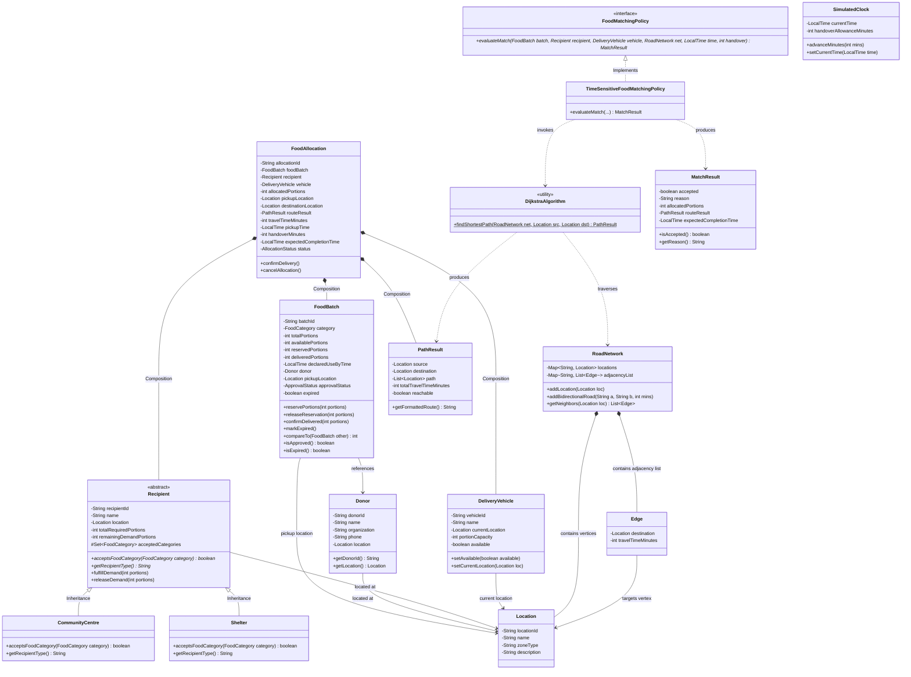

# UML Class Diagram & System Architecture

## 1. Mermaid Class Diagram

---

## 2. Explanation of Object-Oriented Relationships

### A. Inheritance & Runtime Polymorphism
- **Base Abstraction**: `Recipient` provides the abstract template defining organizational demand, location, and the abstract method `acceptsFoodCategory(FoodCategory)`.
- **Concrete Subclasses**: `Shelter` and `CommunityCentre` override `acceptsFoodCategory()`.
  - `Shelter` prioritizes ready-to-eat cooked provisions (`MEALS`, `BIRYANI`, `RICE`, `CHAPATI`, `BREAD`).
  - `CommunityCentre` prioritizes pantry produce and dry goods (`FRUITS`, `VEGETABLES`, `PACKED_FOOD`, `BREAD`, `MEALS`).
- **Polymorphic Invocation**: The `TimeSensitiveFoodMatchingPolicy` calls `recipient.acceptsFoodCategory(batch.getCategory())` dynamically without branching on `instanceof`, adhering to the Open/Closed Principle.

### B. Strict Encapsulation
- `FoodBatch` encapsulates portion states (`availablePortions`, `reservedPortions`, `deliveredPortions`). The `reservePortions()`, `releaseReservation()`, `confirmDelivered()`, and `markExpired()` methods guarantee:
  1. No over-allocation beyond available portions.
  2. No reservations against expired batches.
  3. No reservations against unapproved batches.
  4. No negative balances.
- `FoodAllocation` encapsulates state lifecycle transitions: `confirmDelivery()` cannot confirm an unreserved or already delivered allocation.

### C. Composition
- `FoodAllocation` is composed of:
  - `FoodBatch` (surplus supply)
  - `Recipient` (beneficiary demand)
  - `DeliveryVehicle` (transit capacity)
  - `PathResult` (Dijkstra-computed itinerary)
  - Temporal fields (`pickupTime`, `travelTimeMinutes`, `handoverMinutes`, `expectedCompletionTime`).

### D. Abstraction
- `FoodMatchingPolicy` decouples matching evaluation rules from scheduling coordinators. `TimeSensitiveFoodMatchingPolicy` enforces 12 discrete domain and deadline feasibility rules.
